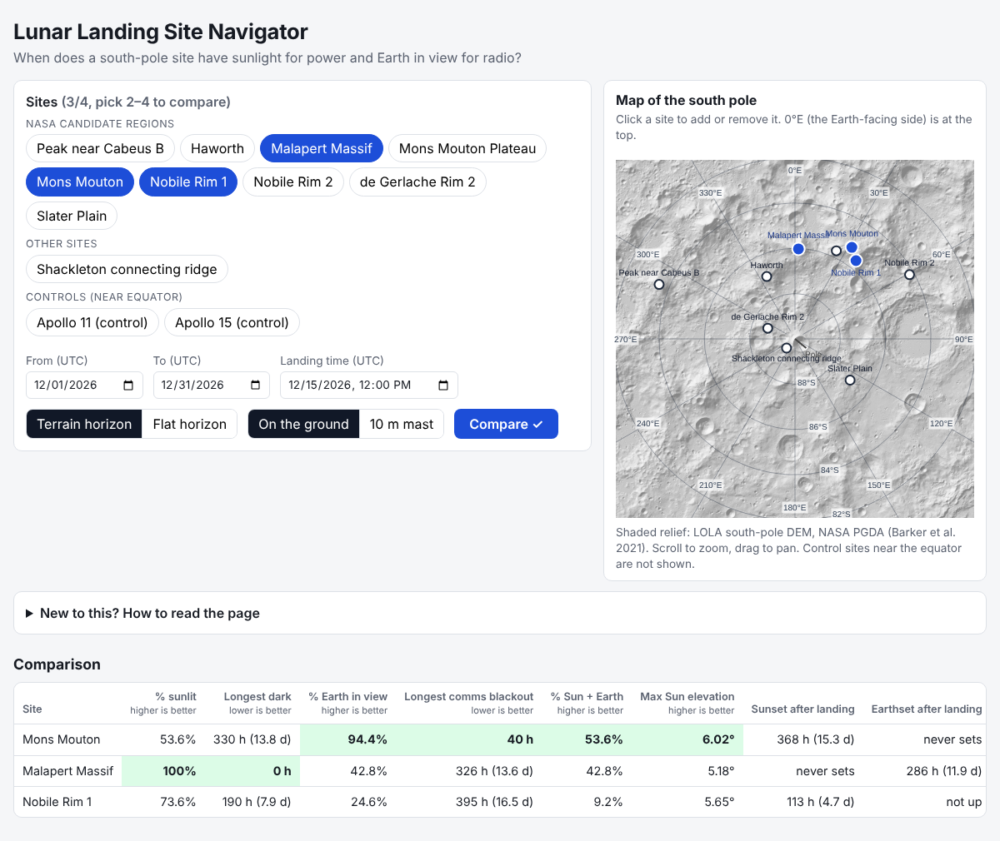
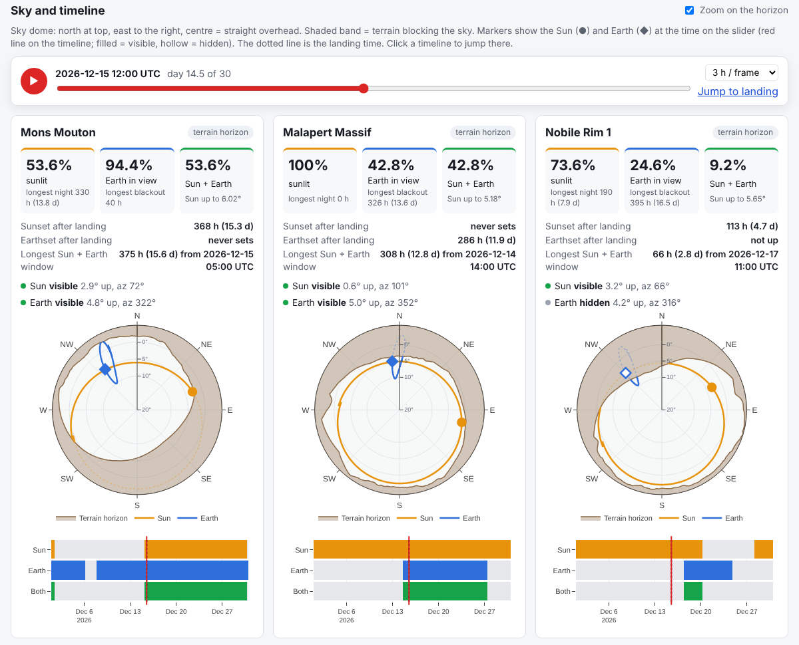

# Lunar Landing Site Navigator

**When does a lunar south-pole landing site have sunlight for power and Earth in view for radio?** Pick 2–4 candidate sites and a date range, and the app answers in seconds, using real NASA terrain and real Sun and Earth positions.

**Live app:** <https://siphrn.github.io/nasaSpaceAppChallenge/> · **API:** <https://lunar-site-navigator-api.onrender.com> ([docs](https://lunar-site-navigator-api.onrender.com/docs)) · Built for the [NASA Space Apps Challenge 2026: Lunar Landing Site Navigator](https://www.spaceappschallenge.org/2026/challenges/lunar-landing-site-navigator/?tab=details)



## Why it matters

At the Moon's south pole the Sun never climbs more than a few degrees. It circles the horizon, so a crater rim or a mountain can hide it for days. Earth hangs right on the horizon too. Moving a lander a kilometre, or slipping the launch two weeks, can turn steady solar power into a 14-day night, or cut radio contact with Earth. Planners answer these questions today by juggling Quickmap, Moon Trek and JPL Horizons. This app puts the answer on one screen.

## What it does

- **Compare sites side by side:** % of time sunlit, longest night (which sets battery size), % of time Earth is in view, longest radio blackout, and the hours both are up. The best value in each column is highlighted.
- **Sky dome per site:** the real terrain horizon in every compass direction, with the Sun's and Earth's paths over it.
- **Timeline and landing time:** when each body is up, hour by hour, plus time left until sunset and Earthset after a chosen landing time.
- **Best landing window:** the first stretch with both Sun and Earth up for at least N hours.
- **Flat vs terrain switch:** shows how much the real landscape changes the answer. On a high point, terrain can *add* sunlight, because you see past the flat horizon.
- **10 m mast switch:** what a solar-panel or antenna mast buys you.
- **Map** of the south pole (LOLA shaded relief), an animation scrubber, and a plain-language "How to read this" panel for students and the public.



## How it works

```text
  JPL Horizons API                      LOLA south-pole elevation map
  (Sun + Earth az/el, hourly)           (80 m/px GeoTIFF, NASA PGDA)
          |                                      |
          v                                      v
  backend/horizons.py                   terrain/horizon_mask.py
  fetch once, cache to JSON             ray-cast the horizon at each site:
          |                             360 directions x 150 km, with the
          |                             Moon's curvature -> masks/*.json
          +------------------+-------------------+
                             v
                  backend/metrics.py:  visible = elevation > horizon(azimuth)
                  backend/app.py (FastAPI): /sites, /ephemeris, /compare
                             v
                  frontend/ (React + TypeScript + Plotly), on GitHub Pages
                  (falls back to a built-in snapshot if the API is asleep)
```

1. **Where are the Sun and Earth?** JPL Horizons gives their azimuth and elevation from each site every hour. Responses are cached, so the app never depends on Horizons being up.
2. **How high is the real horizon?** For each site we walk outward over NASA's LOLA laser-altimeter map in 360 directions, out to 150 km, and keep the steepest angle we see. Far terrain sinks because the Moon curves away (about 2.9 km of drop at 100 km), and we correct for that. The result is a 360-number "horizon mask" per site, plus one for a 10 m mast. Details and checks: [`terrain/README.md`](terrain/README.md), [`terrain/validate.md`](terrain/validate.md).
3. **Compare.** A body is visible when it is above the mask in its direction. There is no atmosphere, so no refraction correction. The metrics come from those hourly yes/no values.

**How we checked the terrain:** fake-Moon tests with mountains at known places; a second, independent method that must agree on every site; the Sun and Earth results against known facts (the Shackleton connecting ridge, known as one of the best-lit spots at the pole, comes out sunlit 100% of these summer weeks); and every site checked against NASA's official candidate-region outlines in Quickmap, which caught one point that sat outside its region and was then moved.

## Data sources

- [JPL Horizons API](https://ssd-api.jpl.nasa.gov/doc/horizons.html): Sun and Earth positions from lunar surface sites
- [LOLA south-pole DEMs, NASA PGDA product 90](https://pgda.gsfc.nasa.gov/products/90) (Barker et al. 2021): `LDEM_80S_80MPP_ADJ.TIF`, 80 m/px
- [LROC Quickmap](https://quickmap.lroc.asu.edu): NASA candidate landing-region outlines, used to check site positions

## Run it locally

```bash
# backend (serves from the committed cache, no network needed)
cd backend && pip install -r requirements.txt
HORIZONS_OFFLINE=1 uvicorn app:app --port 8000

# frontend
cd frontend && npm ci
VITE_API_URL=http://localhost:8000 npm run dev     # http://localhost:5173

# terrain masks (optional: the JSON files are already committed)
pip install -r terrain/requirements.txt
# download LDEM_80S_80MPP_ADJ.TIF (181 MB) from PGDA into terrain/dem/, then:
python terrain/build_masks.py --mast 10
```

## Limitations, in short

Hourly sampling; an 80 m/px map (nearby small hills are smoothed); one exact point per candidate region (moving 1–2 km can change the answer a lot, which is the point of the app); the Sun's centre is what we test; cached dates run from 17 Nov 2026 to 14 Jan 2027, which is polar summer. Full list: [Limitations](#limitations).

## Repo layout

| Folder | What's in it |
| --- | --- |
| `frontend/` | React + TypeScript + Plotly app, offline snapshot, GitHub Pages workflow |
| `backend/` | FastAPI app, Horizons fetch + cache, metrics, tests, `data/sites.json`, `data/masks/` |
| `terrain/` | Horizon-mask ray-caster, build script, validation notes and tests |
| `STATUS.md` | Team status log from the build day |

The rest of this README is the one-day build plan we worked from: concepts, team split, the JSON contracts between the three parts, and the limitations.

---

# Appendix: one-day build plan

_Build plan, Nov 14, 2026_

**Live backend:** <https://lunar-site-navigator-api.onrender.com> (API docs at [`/docs`](https://lunar-site-navigator-api.onrender.com/docs)). It serves from the committed cache only (Nov 17 2026 to Jan 14 2027). It does **not** redeploy on push: after a change to `backend/` merges, redeploy from the Render dashboard (Manual Deploy) or ask A. It is on Render's free plan, so the first request after 15 idle minutes takes about a minute while it wakes up.

## The challenge

Build one screen that answers a planner's question in seconds: *at this south-pole site, on these dates, when do we have sunlight for power and Earth in view for radio?* Today that means juggling Quickmap, Moon Trek and JPL Horizons. The challenge says those tools are built for detailed analysis and are hard for non-specialists to use for quick comparisons ([challenge details](https://www.spaceappschallenge.org/2026/challenges/lunar-landing-site-navigator/?tab=details)).

**Why it matters:** launch delays and hardware problems often force teams to switch landing dates or sites. Engineers then need to compare alternatives quickly. At the south pole, a small move in place or date can change power and communication windows a lot.

**Users the statement names:** mission planners, educators and the public. Build for the planner and add one plain-language "why" panel for everyone else.

**What the statement suggests (all optional):**

- Curated sites (Apollo, CLPS targets, other countries' sites) **plus** custom coordinates
- Side-by-side comparison of sites and dates
- Sun and Earth position against the horizon, with **time left until sunset or Earthset**
- Solar elevation angle shown prominently, sunlight duration, Earth visibility windows
- Timeline or animation across a lunar day; 2D or 3D views
- Use real LOLA topography for the horizon; there is no atmospheric refraction on the Moon
- Optional extra accuracy: libration and orbital variation

**Difficulty:** Intermediate / Advanced. **Subjects:** Human Exploration, Moon, Software, Space Exploration.

## Core concepts (the 5 ideas the whole app rests on)

1. **Azimuth and elevation.** From a point on the surface, any body in the sky has an azimuth (compass direction, 0–360°) and an elevation (angle above the flat local horizontal). Horizons gives you both for the Sun and Earth.
2. **Horizon mask.** The real horizon isn't flat: crater rims and massifs block the sky. For each azimuth you compute the highest terrain angle seen from the site, giving a curve `mask(az)`. A body counts as **visible** when `elevation > mask(azimuth)`. With no atmosphere there's no refraction to correct for, so the comparison is purely geometric.
3. **The Sun barely rises at the pole.** At the south pole the Sun sits only a few degrees above the horizon and circles all the way around it. A rim or peak can block it for hours or days, which is why location matters so much.
4. **Earth hardly moves.** From the Moon, Earth stays in nearly the same patch of sky, wobbling a few degrees because of libration. At the pole that patch sits right on the horizon, so some sites see Earth for half the month and others almost never. That difference is the core of the comms story.
5. **Metrics planners want:**
   - % of time sunlit, and the longest dark gap (sets battery size)
   - Solar elevation over time (sets panel tilt; low sun means vertical arrays)
   - % of time Earth is visible, and the longest comms blackout
   - Time until the next sunset or Earthset from a chosen landing time
   - Overlap windows: Sun **and** Earth both visible (the best time to land)

A single number per site, like "62% sunlit, longest night 4.1 days, Earth visible 48%", is what makes comparisons quick.

## Data sources

You need only two datasets, plus a short site list you put together by hand.

| Source | What you get | How to use it | Watch out for |
| --- | --- | --- | --- |
| [JPL Horizons API](https://ssd-api.jpl.nasa.gov/doc/horizons.html) | Sun (`COMMAND='10'`) and Earth (`COMMAND='399'`) azimuth/elevation from a surface site, at any time step | `EPHEM_TYPE='OBSERVER'`, `CENTER='coord@301'` (301 = Moon), `COORD_TYPE='GEODETIC'`, `SITE_COORD='E-lon,lat,alt_km'`, `STEP_SIZE='1 h'`, `CSV_FORMAT='YES'`, `format=json` | Commas in `SITE_COORD` must be URL-encoded as `%2C`. Up to 10,000 times per request via `TLIST`, and the API states no rate limits. Check the az/el quantity code in the Horizons manual (usually `QUANTITIES='4'`) |
| [LOLA south-pole DEMs (NASA PGDA)](https://pgda.gsfc.nasa.gov/products/90) | Elevation GeoTIFFs covering 80–90°S at 20, 40, 80 m/px and coarser, in polar stereographic | Read a window around each site with `rasterio` and ray-cast the horizon mask | The 20 m/px file is 2.6 GB. Start with 80 m/px or coarser and crop to \~100–150 km around your sites |
| [LOLA 5 m/px site DEMs](https://pgda.gsfc.nasa.gov/products/78) | High-accuracy tiles around priority sites, including Site 01 "Connecting ridge" | Stretch goal: a zoomed "high-res" mode | Small coverage areas |
| [Quickmap](https://quickmap.lroc.asu.edu) / [Moon Trek](https://trek.nasa.gov/moon) | Visual check and site coordinates | Pull lat/lon for each site; take screenshots for the README | For manual use, not an API |

**Curated site list (fill in coordinates from Quickmap):** the nine NASA candidate south-pole regions (Peak near Cabeus B, Haworth, Malapert Massif, Mons Mouton Plateau, Mons Mouton, Nobile Rim 1, Nobile Rim 2, de Gerlache Rim 2, Slater Plain), Shackleton rim / connecting ridge, plus 1–2 Apollo sites as near-equator controls. The controls make the polar weirdness obvious.

**Horizon math (curved Moon, R = 1,737.4 km).** For terrain at distance d and height h\_t, seen from a site at height h\_s:

```math
\theta = \arctan\left( \frac{h_t - h_s - d^2/(2R)}{d} \right)
```

The mask at each azimuth is the largest θ along that ray. Use 360 or 720 rays, with samples every 1–2 pixels out to \~100–150 km.

## Architecture

```text
  JPL Horizons API                      LOLA south-pole DEM
  (Sun + Earth positions in the sky)    (GeoTIFF terrain elevation)
          |                                      |
          v                                      v
  1. horizons.py                        2. horizon_mask.py
     fetch az/el per site,                 ray-cast the terrain horizon
     cache to cache/*.json                 once per site, save masks/*.json
          |                                      |
          +------------------+-------------------+
                             |
                             v
                  3. metrics.py
                     visible = elevation > mask(azimuth)
                     % sunlit, longest night, % Earth visible, overlaps
                             |
                             v
                  FastAPI  (GET /sites, /ephemeris, /compare)
                             |
                             v
                  React + Plotly UI
                  (sky plot, timeline strip, metric cards, compare mode)
```

Two data feeds go in: JPL Horizons gives where the Sun and Earth are in the sky, and the LOLA elevation map gives the shape of the terrain around each site. Three processing steps turn those into answers: fetch and cache the sky positions, compute each site's horizon mask once, then compare the two to produce visibility and metrics. One UI shows the results.

Terrain masks are computed once per site and saved, so the live app only does cheap work: look up cached ephemerides, compare elevation with the mask, and return metrics. Solo with little time? Merge FastAPI and React into one Streamlit app; the boxes stay the same.

## Features: MVP first, then stretch

Ship the MVP by mid-afternoon. Each stretch feature is independent, so stop whenever time runs out.

| Tier | Feature | Why judges/recruiters care | Effort |
| --- | --- | --- | --- |
| MVP | Site picker (curated list + custom lat/lon) and date range | Directly answers the brief | 1 h |
| MVP | Sky-dome / polar plot: Sun and Earth tracks over the horizon mask | The signature visual | 2 h |
| MVP | Timeline strip: sunlit / Earth-visible / both, hour by hour | Shows the windows at a glance | 1 h |
| MVP | Metric cards: % sunlit, longest night, % Earth-visible, longest blackout, time to next sunset/Earthset | Rapid comparison, the core ask | 1 h |
| MVP | Compare mode: 2–4 sites side by side | Shows the "small move, big change" effect | 1 h |
| Stretch | Real terrain horizon from LOLA (if MVP used a flat horizon) | Accuracy; the strongest technical talking point | 2–3 h |
| Stretch | Map view: south-pole hillshade with clickable sites (Leaflet or deck.gl) | Spatial intuition | 1–2 h |
| Stretch | "Best landing window" finder: first N hours with both Sun and Earth up for at least X days | Turns the data into a decision | 1 h |
| Stretch | Animation scrubber across a lunar day | Engaging demo | 1 h |
| Stretch | Mast-height slider (panel at 0 m vs 10 m) | Shows why towers matter at the pole | 1 h |
| Stretch | "Explain it" panel for students | Covers the educator/public audience | 30 min |

Cut order if behind: map view → animation → mast slider. Never cut compare mode; it is the brief.

## Schedule and checklist (about 12 working hours)

Order matters: get real numbers flowing end-to-end before polishing anything. A working ugly app at hour 5 beats a pretty half-app at hour 11.

**Hour 0–1: setup**

- [ ] Create repo, `backend/` (FastAPI) and `frontend/` (Vite + React + TypeScript), or one Streamlit app if solo
- [ ] Write `sites.json` with name, lat, E-lon, short note for 8–12 sites (coordinates from Quickmap)
- [ ] Register the Space Apps team and project page

**Hour 1–3: ephemeris pipeline**

- [ ] `horizons.py`: fetch Sun + Earth az/el for one site, 1 h step, 30 days; parse the CSV block out of `result`
- [ ] Cache responses to disk (`cache/{site}_{body}_{start}_{stop}.json`) so the demo never depends on the network
- [ ] Sanity check: at a near-equator Apollo site the Sun should rise to high elevation; at the pole it should stay low

**Hour 3–5: visibility + metrics**

- [ ] Flat-horizon version first: `visible = elevation > 0`
- [ ] `metrics.py`: % sunlit, longest dark gap, % Earth-visible, longest blackout, next sunset/Earthset from time t, overlap windows
- [ ] API: `GET /sites`, `GET /ephemeris?site=&start=&stop=`, `GET /compare?sites=a,b,c&start=&stop=`

**Hour 5–8: frontend MVP**

- [ ] Site multi-select + date range picker
- [ ] Polar sky plot (Plotly `scatterpolar`: radius = 90 − elevation, angle = azimuth), with the horizon mask as a filled band
- [ ] Timeline strip (three rows: Sun, Earth, both)
- [ ] Metric cards + comparison table, best value per column highlighted

**Hour 8–10: terrain horizon (the differentiator)**

- [ ] Download a coarse south-pole LDEM, crop with `rasterio`, convert site lat/lon to polar-stereo x/y
- [ ] Ray-cast 360 azimuths, with curvature correction; save `masks/{site}.json`
- [ ] Swap `elevation > 0` for `elevation > mask(azimuth)`; show both numbers to show how much terrain matters

**Hour 10–12: ship it**

- [ ] Deploy (frontend on Vercel/Netlify, backend on Render/Railway, or Streamlit Community Cloud)
- [ ] README with screenshot/GIF, architecture, data sources, limitations
- [ ] 30–60 s demo video; submit on the Space Apps project page

## Team split (3 people)

This section is written for a handoff: each lane can be picked up cold by someone who has read only this README. Lanes are ordered **hardest to easiest**. Each person owns their files; touch someone else's files only after telling them.

| Lane | Person | Owns | Difficulty | Hand to |
| --- | --- | --- | --- | --- |
| C | Terrain horizon masks (+ README/submission) | `terrain/`, `backend/data/masks/` | Hardest | Strongest math / Python person |
| A | Data and backend | `backend/` (except `data/masks/`), `sites.json` | Medium | Someone steady; everyone depends on this lane |
| B | Frontend | `frontend/` | Easiest technically, most polish | Best eye for design |

> Optional: if C is behind, move the README, "Explain it" panel text and submission work from C to B, so C can focus only on terrain.

### Repo layout everyone agrees on

```text
backend/
  app.py              # FastAPI app (A)
  horizons.py         # JPL Horizons fetch + cache (A)
  metrics.py          # visibility + metrics (A)
  data/
    sites.json        # curated site list (A)
    cache/            # cached Horizons responses, committed for the demo (A)
    masks/            # one JSON per site, produced by C
  requirements.txt
terrain/
  horizon_mask.py     # ray-caster (C)
  build_masks.py      # runs horizon_mask over every site, writes backend/data/masks/ (C)
  validate.md         # notes + screenshots comparing masks with Quickmap (C)
  dem/                # downloaded LOLA GeoTIFFs, NOT committed (add to .gitignore)
frontend/
  src/                # Vite + React + TypeScript (B)
  src/mock/           # fake API responses matching the contracts below (B)
```

### Shared contracts (agree in hour 0, about 15 minutes)

These shapes are the only thing the three lanes share. Once they are fixed, nobody waits on anybody: B builds against mock files, C writes files A can read, and A serves them. **Change a contract only after all three agree, and update this section in the same commit.**

Conventions for all of them: times are UTC ISO-8601 strings (`"2026-12-01T00:00:00Z"`); angles are degrees; azimuth is measured clockwise from local north (0 = north, 90 = east); longitudes are **east-positive, 0–360** (`lon_e`); latitudes are negative in the south.

**1. `backend/data/sites.json`** (written by A, read by A and C)

```json
[
  {
    "id": "haworth",
    "name": "Haworth",
    "lat": -87.45,
    "lon_e": 355.0,
    "group": "candidate",
    "note": "NASA Artemis candidate region"
  },
  {
    "id": "apollo11",
    "name": "Apollo 11 (control)",
    "lat": 0.674,
    "lon_e": 23.473,
    "group": "control",
    "note": "Near-equator control site"
  }
]
```

`id` is lowercase with underscores and is used in file names and URLs. `group` is `"candidate"`, `"other"` or `"control"`. The coordinates above are placeholders: take real ones from Quickmap.

**2. `backend/data/masks/{site_id}.json`** (written by C, read by A)

```json
{
  "site": "haworth",
  "n_az": 360,
  "az_step_deg": 1.0,
  "mask_deg": [1.84, 1.91, 2.03, 2.10],
  "dem": "LDEM_80S_80MPP_ADJ.TIF",
  "dem_res_m": 80,
  "max_km": 120,
  "site_height_m": 0,
  "generated_at": "2026-11-14T18:00:00Z"
}
```

`mask_deg` always has exactly `n_az` numbers (360 here; the example is shortened). `mask_deg[i]` is the elevation angle of the terrain horizon at azimuth `i * az_step_deg`. It can be negative on a peak, because a peak sees past the flat horizon. A body is visible when `elevation > mask_deg(azimuth)`.

**3. `GET /sites`** (served by A, used by B): returns the `sites.json` array as is.

**4. `GET /ephemeris?site=haworth&start=2026-12-01&stop=2026-12-31&step_h=1&horizon=terrain`** (served by A, used by B for the sky plot and timeline)

```json
{
  "site": "haworth",
  "start": "2026-12-01T00:00:00Z",
  "stop": "2026-12-31T00:00:00Z",
  "step_h": 1,
  "horizon": "terrain",
  "mast_m": 0,
  "times": ["2026-12-01T00:00:00Z", "2026-12-01T01:00:00Z"],
  "sun":   { "az": [123.4, 124.0], "el": [1.2, 1.3], "visible": [false, true] },
  "earth": { "az": [355.1, 355.2], "el": [2.8, 2.8], "visible": [true, true] },
  "mask_deg": [1.84, 1.91, 2.03, 2.10]
}
```

`horizon` is `"flat"` or `"terrain"`. With `"flat"`, `mask_deg` is `null` and visible means `el > 0`. If `"terrain"` is asked for and no mask file exists yet, the API falls back to flat and returns `"horizon": "flat"`, so the UI can show a label. Arrays in the examples are shortened. All arrays have the same length as `times`, except `mask_deg`, which has `n_az` entries.

Optional `mast_m` (mast height in metres; C ships `0` and `10`): with `horizon=terrain&mast_m=10` the API reads `masks/{site_id}_h10.json` (same format as contract 2, `site_height_m: 10`). If that file is missing it falls back to the 0 m mask. The response's `mast_m` is the height actually used (always `0` for a flat horizon or a fallback). Default `0`.

**5. `GET /compare?sites=haworth,malapert,nobile_rim_1&start=...&stop=...&step_h=1&horizon=terrain&land_at=2026-12-05T12:00:00Z`** (served by A, used by B for metric cards and the comparison table)

```json
{
  "start": "2026-12-01T00:00:00Z",
  "stop": "2026-12-31T00:00:00Z",
  "step_h": 1,
  "land_at": "2026-12-05T12:00:00Z",
  "results": [
    {
      "site": "haworth",
      "name": "Haworth",
      "horizon": "terrain",
      "mast_m": 0,
      "pct_sunlit": 62.1,
      "longest_dark_h": 98,
      "pct_earth": 48.3,
      "longest_blackout_h": 210,
      "pct_both": 31.0,
      "max_sun_el_deg": 3.9,
      "mean_sun_el_deg": 1.6,
      "next_sunset_h": 41,
      "next_earthset_h": 12,
      "both_windows": [
        { "start": "2026-12-02T03:00:00Z", "stop": "2026-12-04T19:00:00Z", "hours": 64 }
      ]
    }
  ]
}
```

`land_at` is optional; without it, `next_sunset_h` and `next_earthset_h` are measured from `start`. They are `null` if the body is not visible at that time, and `-1` if it never sets in the range. `both_windows` lists every stretch where the Sun **and** Earth are both visible. `/compare` takes the same optional `mast_m` as `/ephemeris`, and each result reports its own `horizon` and `mast_m` (one site can fall back while another doesn't).

### Timeline and integration points

| When | Who | What has to be true |
| --- | --- | --- |
| Hour 0–0.25 | All | Contracts above agreed, repo layout created, `.gitignore` covers `terrain/dem/` |
| Hour 1 | A | `sites.json` committed with real coordinates (C needs it to start building masks) |
| Hour 1 | B | Mock files in `frontend/src/mock/` that match contracts 3–5 exactly |
| Hour 3 | A | `/sites`, `/ephemeris` and `/compare` running locally with a flat horizon |
| **Hour 5: flat-horizon join-up** | A + B | B switches from mocks to the real API. The full app works end to end with a flat horizon. This is the safety net: if nothing else ships, this does |
| Hour 6 | C | First mask for one site, checked against Quickmap (rotation sign confirmed) |
| Hour 8 | C | Masks for all sites in `backend/data/masks/` |
| **Hour 10: terrain swap** | A + C | A's API serves `horizon=terrain` from C's files. B's flat/terrain toggle shows both numbers |
| Hour 10–12 | All | A deploys the backend, B deploys the frontend and records the demo, C finishes README and submission |

---

### Lane C: terrain horizon masks (hardest)

**Goal.** For every site, produce a 360-number curve saying how high the real terrain horizon is in each compass direction. This is what makes the app accurate at the pole and is the strongest technical talking point.

**You own.** `terrain/horizon_mask.py`, `terrain/build_masks.py`, `terrain/validate.md`, and everything in `backend/data/masks/`. Later (unless moved to B): README, the "Explain it" panel text, and the Space Apps submission.

**Inputs.** `backend/data/sites.json` from A (hour 1). A LOLA south-pole DEM GeoTIFF from [NASA PGDA product 90](https://pgda.gsfc.nasa.gov/products/90).

**Outputs.** `backend/data/masks/{site_id}.json` in contract 2, one per south-pole site. Control (equator) sites do not need a mask; the API uses a flat horizon for them.

**Libraries you will use.** `rasterio` (reads GeoTIFFs and their map projection), `pyproj` (converts lat/lon to the DEM's x/y metres), `numpy` (array maths). Install with `pip install rasterio pyproj numpy`.

**Tasks**

- [ ] Download the **coarsest** south-pole LDEM first (80 m/px or coarser). Do not start with the 20 m/px file: it is 2.6 GB. Put it in `terrain/dem/` and make sure that folder is git-ignored.
- [ ] Open it with `rasterio` and print `ds.crs`, `ds.transform`, `ds.shape` and `ds.nodata`. Confirm it is polar stereographic and the units are metres.
- [ ] Read only a window around each site, not the whole file: about ±150 km. Use `rasterio.windows.from_bounds` with the site's x/y ± 150,000 m.
- [ ] Convert each site's `lat, lon_e` to DEM x/y with `pyproj.Transformer` (see the code starter). Check the site lands on a sensible pixel: its height should match what Quickmap shows within about 100 m.
- [ ] Ray-cast 360 azimuths, sampling every 1–2 pixels out to 120 km, using the curvature formula `θ = arctan((h_t − h_s − d²/2R) / d)` with `R = 1,737,400 m`. Take the max θ along each ray.
- [ ] **Fix the azimuth rotation.** In polar stereographic, the grid's "up" is not local north. Rotate each ray by the site's longitude so azimuth 0 points to local north (toward the equator at the south pole). The code starter has one version of this rotation; its sign may be wrong.
- [ ] Validate on one site before doing the rest (see below). Write what you checked, with screenshots, in `terrain/validate.md`.
- [ ] Write `build_masks.py`: loop over `sites.json`, skip `group == "control"`, write one file per site in contract 2. Commit the JSON files (they are small).
- [ ] Optional stretch: a `site_height_m` parameter (mast height, e.g. 10 m) so B can build the mast-height slider. Write extra files as `masks/{site_id}_h10.json` and tell A.

**How to validate**

- Sanity: values should mostly sit between about −2° and +10°. A mask full of 0s means rays left the window or hit nodata; values of 40°+ mean a units or pixel-size mistake.
- Direction check: pick a site next to a big crater rim whose direction you can see in Quickmap (e.g. Shackleton's rim seen from the connecting ridge). The mask must peak in that direction. If it peaks on the opposite or mirrored side, flip the rotation sign.
- Cross-check with A: once A's `/ephemeris` works, the Sun at a well-lit ridge site should be visible for most of the month with your mask. If a famously well-lit site comes out mostly dark, suspect the rotation.

**Known pitfalls**

- Rotation sign in polar stereographic. This is the most likely bug in the whole project.
- Longitude convention: the plan uses east-positive 0–360. A site at "5° W" is `lon_e = 355`.
- Pixel indices: `~ds.transform * (x, y)` gives `(col, row)`, not `(row, col)`. Index arrays as `z[row, col]`.
- Nodata values (often −32768 or very large numbers) must be masked out before taking the max.
- Height units: some LOLA products store heights relative to a 1737.4 km sphere in metres, some in km. Check the product page.

**Definition of done**

- [ ] Every non-control site in `sites.json` has a mask file that passes the sanity range.
- [ ] At least one site is checked against Quickmap, with notes and a screenshot in `terrain/validate.md`.
- [ ] `python terrain/build_masks.py` rebuilds all masks from a clean checkout plus the downloaded DEM, with no manual steps.
- [ ] A has confirmed `horizon=terrain` reads your files.

---

### Lane A: data and backend (medium)

**Goal.** Turn "site + date range" into numbers: fetch where the Sun and Earth are from JPL Horizons, cache it, decide when each is visible, compute the metrics and serve them over a small HTTP API.

**You own.** `backend/app.py`, `backend/horizons.py`, `backend/metrics.py`, `backend/data/sites.json`, `backend/data/cache/`, `backend/requirements.txt`, and the backend deployment.

**Inputs.** Site coordinates from [Quickmap](https://quickmap.lroc.asu.edu). Sun/Earth positions from the [JPL Horizons API](https://ssd-api.jpl.nasa.gov/doc/horizons.html). Later, C's mask files.

**Outputs.** The three endpoints in contracts 3–5, running locally by hour 3 and deployed by hour 12.

**Libraries you will use.** `requests` (calls Horizons), `numpy` (visibility arrays), `fastapi` + `uvicorn` (the web API: you write plain Python functions and FastAPI turns them into URLs that return JSON). Install with `pip install fastapi uvicorn requests numpy`.

**Tasks**

- [ ] Hour 0–1: write `sites.json` (contract 1) with 8–12 sites: the nine NASA candidate regions, Shackleton connecting ridge, and 1–2 Apollo sites as controls. Commit it early: C is waiting on it.
- [ ] Try one Horizons query by hand in the [Horizons web app](https://ssd.jpl.nasa.gov/horizons/app.html): observer on the Moon (body 301), site coordinates, target Sun (10), quantity "apparent az & el". Copy the exact settings that work.
- [ ] `horizons.py`: implement `azel(site, body, start, stop, step)` from the code starter. Parse the rows between `$$SOE` and `$$EOE`. Convert Horizons time strings to ISO UTC.
- [ ] Cache every response to `backend/data/cache/` and commit the cache for your demo dates, so the deployed app never calls Horizons live.
- [ ] Sanity check: at an Apollo site the Sun should climb to high elevation (60°+); at the pole it should stay within a few degrees of the horizon. Earth at the pole should hover near the horizon and barely move.
- [ ] `metrics.py`: `visible()`, `longest_run()` and `summarize()` from the code starter, plus `next_set_h(visible, start_index)`, `both_windows(times, sun_vis, earth_vis)`, and `max_sun_el_deg` / `mean_sun_el_deg` (mean over sunlit hours only).
- [ ] Write a few tiny tests for `metrics.py` with hand-made arrays (e.g. `[T, T, F, F, F, T]` → longest dark = 3). These catch most bugs.
- [ ] `app.py`: `GET /sites`, `GET /ephemeris`, `GET /compare` exactly as in contracts 3–5. Enable CORS so B's dev server can call it. Return HTTP 400 with a clear message for an unknown site or a bad date.
- [ ] Hour 5: sit with B, switch the frontend from mocks to your API, fix any mismatch **in the contract doc first**, then in code.
- [ ] Hour 8–10: load `masks/{site_id}.json` when `horizon=terrain`; fall back to flat (and say so in the response) if the file is missing.
- [ ] Hour 10–12: deploy (Render or Railway), with the cache and masks included. Give B the public URL.

**How to validate**

- Run `uvicorn app:app --reload` and open `http://localhost:8000/docs`: FastAPI generates a page where you can try every endpoint in the browser.
- Compare one site's flat-horizon `pct_sunlit` with your own hand count over a few days of the raw cache.
- `horizon=terrain` should give **less or equal** sunlight than `flat` at most sites. More sunlight is possible only at a peak (negative mask), so check any big increase.
- Run the demo queries (Haworth vs Malapert vs Nobile Rim 1, plus the same dates shifted two weeks) with the network off: they must still work from cache.

**Known pitfalls**

- Commas in `SITE_COORD` must be URL-encoded; `requests` does this for you if you pass `params=`. Don't build the URL by hand.
- Check the az/el quantity code in the Horizons manual (usually `QUANTITIES='4'`) and that `ANG_FORMAT='DEG'` gives decimal degrees.
- Horizons returns an error message inside `result` with HTTP 200. Check for `$$SOE` and raise a clear error if it is missing.
- Keep `lon_e` east-positive 0–360 everywhere; Horizons `SITE_COORD` expects east longitude first.
- Time zones: keep everything in UTC.

**Definition of done**

- [ ] All three endpoints match contracts 3–5 exactly, checked against B's mock files.
- [ ] The Apollo and pole sanity checks pass.
- [ ] `metrics.py` tests pass.
- [ ] The demo works offline from the committed cache.
- [x] Deployed backend URL is shared with B and written in this README.

---

### Lane B: frontend (easiest technically, most polish)

**Goal.** The one screen a planner uses: pick sites and dates, see the Sun and Earth over the horizon, and compare sites at a glance. You can build all of it from mock data before the backend exists.

**You own.** Everything in `frontend/`, the frontend deployment and the demo video. Possibly the README and submission, if moved from C.

**Inputs.** Contracts 3–5. Mock files first, A's local API from hour 5, A's deployed URL at the end.

**Outputs.** A deployed web app (Vercel or Netlify) and a 30–60 s demo video.

**Libraries you will use.** Vite (dev server and build tool), React + TypeScript (UI components with typed data), Plotly via `react-plotly.js` (charts; `scatterpolar` draws the sky dome). Start with `npm create vite@latest frontend -- --template react-ts`, then `npm install plotly.js react-plotly.js`.

**Tasks**

- [ ] Hour 0–1: create the Vite app. Write TypeScript types that mirror contracts 3–5 exactly (`Site`, `EphemerisResponse`, `CompareResponse`).
- [ ] Write mock JSON for 3 sites in `src/mock/`, matching the contracts field for field. Make one site clearly better so the "best value" highlight is testable.
- [ ] One `api.ts` file with `getSites()`, `getEphemeris()`, `getCompare()`. A single flag switches between mocks and the real base URL (an env var like `VITE_API_URL`).
- [ ] Site multi-select (2–4 sites, grouped by `group`) + date range picker + flat/terrain toggle.
- [ ] **Polar sky plot** (the signature visual): Plotly `scatterpolar` with `r = 90 − elevation`, `theta = azimuth`, angular axis clockwise with 0° at the top (`angularaxis: {rotation: 90, direction: "clockwise"}`). Draw the horizon mask as a filled band from `r = 90 − mask` out to the edge, then the Sun and Earth tracks on top.
- [ ] **Timeline strip**: three rows (Sun, Earth, both), one cell per hour, coloured when visible. A heatmap or shapes in Plotly both work.
- [ ] **Metric cards + comparison table**: one row per site with the `/compare` fields. Highlight the best value per column (highest for `pct_*`, lowest for `longest_*`).
- [ ] Show `horizon` clearly: if the API fell back to flat, label it "flat horizon (terrain not available)".
- [ ] Hour 5: switch to the real API with A and fix mismatches.
- [ ] Stretch, in this order (cut from the bottom if behind): "best landing window" highlight from `both_windows`, "Explain it" panel for students, animation scrubber, map view, mast-height slider.
- [ ] Hour 10–12: deploy, set `VITE_API_URL` to A's URL, add a footer crediting NASA/JPL Horizons and LOLA/PGDA, record the demo (script in "Demo, submission and resume").

**How to validate**

- The sky plot must put north at the top and east to the right (clockwise). Check with a fake point at az 90°, el 45°: it should sit halfway out on the right.
- At an Apollo control site the Sun track should reach near the centre of the dome; at a pole site it should hug the edge. If not, `r` is probably inverted.
- Toggling flat/terrain should change the numbers and the shaded horizon band.
- Test at phone width; judges often open links on phones.

**Known pitfalls**

- Plotly's polar plot defaults to counter-clockwise with 0° on the right. Set `rotation` and `direction` explicitly.
- Azimuth wraps at 360 → 0. Break the track line there, or Plotly draws a line straight across the dome.
- Large arrays (720 hours × 4 sites) are fine for Plotly, but don't re-render on every keystroke: fetch only when the user clicks "Compare" or the inputs settle.
- CORS errors in the browser console mean A needs to enable CORS, not a frontend bug.

**Definition of done**

- [ ] Every MVP feature in the Features table works against the real API.
- [ ] The app works deployed, at phone width, with credits in the footer.
- [ ] The demo video is recorded (under 2 minutes) and linked on the project page.

## Workflow (Saturday, Nov 14)

Who is who: **Lucas is Person C** (terrain). Person A has started on the backend. Person B starts soon. All times are Eastern (ET). This is the clock-time version of the hour-by-hour plan above; where the two differ, follow this one.

### Git rules (everyone)

- Each person works on their own branches: `backend/*` for A, `frontend/*` for B, `terrain/*` for C (e.g. `terrain/ray-cast`).
- Stay in your own folder so nobody edits the same file: `backend/` for A (except `backend/data/masks/`), `frontend/` for B, `terrain/` and `backend/data/masks/` for C.
- Make small PRs into `main`, and have one teammate glance at each before it merges. Pull `main` at least once an hour.
- The JSON formats in "Shared contracts" are the agreement between lanes. If one has to change, say so in team chat first, and update the README in the same PR.

### Status tracking (required)

[`STATUS.md`](STATUS.md) shows where everyone is right now: status, current task, branch, blockers, next step and a short log. **Everyone must keep their own section of it up to date:**

- Update it when you **start** a task, **finish** a task, or get **blocked**, and at every sync (12:00, 4:00, 6:00).
- Change the "At a glance" row, your own section, and add one line to the top of the Log.
- Edit only your own row and section, so updates never conflict.
- `STATUS.md` updates are the one exception to the PR rule: commit them straight to `main` (`git pull`, edit, `git commit -m "status: C ray-casting first site"`, `git push`), so they show up right away.
- Before starting work or asking someone for something, read `STATUS.md` first.

### Schedule

| Time (ET) | A: data and backend | B: frontend | C: terrain (Lucas) |
| --- | --- | --- | --- |
| 11:00–12:00 | `sites.json` with real Quickmap coordinates, then the Horizons fetch | On arrival: Vite scaffold, plus mock JSON copied from the README samples | Download the coarse south-pole DEM, set up `rasterio` and `pyproj`, crop around the sites |
| **12:00 sync (5 min)** | Shares the final site IDs | | Keys mask files by those IDs |
| 12:00–2:00 | `metrics.py` and the `/sites`, `/ephemeris` and `/compare` endpoints | Site and date picker, plus the sky plot, on mock data | Ray-cast a single site and check the rotation against Quickmap |
| 2:00–4:00 | Merges a working backend with a flat horizon | Switches from mock data to the real API | Runs every site, writes `backend/data/masks/{site_id}.json`, opens a PR |
| **4:00 sync: first end-to-end app** | It runs, ugly but real | | |
| 4:00–6:00 | Wires up `elevation > mask(azimuth)`; exposes both flat and terrain numbers | Timeline, metric cards, compare mode, flat/terrain toggle | Validates a second site, then starts the README limitations section and the "Explain it" text |
| **6:00 sync: feature freeze** | After this, only fixes go in | | |
| 6:00–8:00 | Deploys the backend | Deploys the frontend, records the demo | Finishes the README and the submission, checks the demo against the demo script |
| **8:00** | **Submit** | | |

### If you fall behind

- If the masks aren't solid by 4:00, ship the flat horizon, label it clearly, and list terrain as the next step in this README.
- Cut stretch features in this order: map view, then animation, then the mast-height slider. Never cut compare mode.

## Code starter

Three small modules cover the whole backend. This is untested starter code, so run the sanity checks in the schedule before you build on it.

**1. Fetch Sun/Earth az/el from Horizons**

```python
# horizons.py
import json, pathlib, requests

API = "https://ssd.jpl.nasa.gov/api/horizons.api"
CACHE = pathlib.Path("cache"); CACHE.mkdir(exist_ok=True)
BODIES = {"sun": "10", "earth": "399"}

def azel(site, body, start, stop, step="1 h"):
    """site = {'id','lat','lon_e'}; returns [(iso_time, az_deg, el_deg), ...]"""
    key = CACHE / f"{site['id']}_{body}_{start}_{stop}_{step.replace(' ', '')}.json"
    if key.exists():
        return json.loads(key.read_text())
    params = {
        "format": "json",
        "COMMAND": f"'{BODIES[body]}'",
        "EPHEM_TYPE": "'OBSERVER'",
        "CENTER": "'coord@301'",          # surface site on the Moon
        "COORD_TYPE": "'GEODETIC'",
        "SITE_COORD": f"'{site['lon_e']},{site['lat']},0'",  # requests encodes the commas
        "START_TIME": f"'{start}'",
        "STOP_TIME": f"'{stop}'",
        "STEP_SIZE": f"'{step}'",
        "QUANTITIES": "'4'",              # apparent azimuth & elevation: confirm in the manual
        "ANG_FORMAT": "'DEG'",
        "CSV_FORMAT": "'YES'",
    }
    r = requests.get(API, params=params, timeout=60)
    r.raise_for_status()
    text = r.json()["result"]
    block = text.split("$$SOE")[1].split("$$EOE")[0]
    rows = []
    for line in block.strip().splitlines():
        f = [x.strip() for x in line.split(",")]
        nums = []
        for x in f[1:]:
            try: nums.append(float(x))
            except ValueError: pass       # skip the blank/flag columns
        rows.append((f[0], nums[0], nums[1]))
    key.write_text(json.dumps(rows))
    return rows
```

**2. Terrain horizon mask from a LOLA GeoTIFF**

```python
# horizon_mask.py
import numpy as np, rasterio
from pyproj import Transformer

R = 1_737_400.0  # lunar radius, m

def horizon_mask(dem_path, lat, lon_e, n_az=360, max_km=120, step_px=1.5):
    with rasterio.open(dem_path) as ds:
        to_xy = Transformer.from_crs("+proj=longlat +R=1737400 +no_defs", ds.crs, always_xy=True)
        x0, y0 = to_xy.transform(lon_e, lat)
        z = ds.read(1).astype(np.float32)    # crop the file first; full-res is GBs
        inv = ~ds.transform
        px = abs(ds.transform.a)
        col0, row0 = inv * (x0, y0)
        h_site = z[int(row0), int(col0)]
        dists = np.arange(step_px * px, max_km * 1000, step_px * px)
        mask = np.zeros(n_az)
        for i, az in enumerate(np.linspace(0, 360, n_az, endpoint=False)):
            # NOTE: in polar stereo, grid 'north' != local north. Rotate by the
            # site's longitude so az=0 points to the local north (toward the equator at the S pole).
            a = np.radians(az)
            dx, dy = np.sin(a), np.cos(a)
            th = np.radians(lon_e)
            gx = dx * np.cos(th) + dy * np.sin(th)
            gy = -dx * np.sin(th) + dy * np.cos(th)
            cols, rows = inv * (x0 + gx * dists, y0 + gy * dists)
            ok = (rows >= 0) & (rows < z.shape[0]) & (cols >= 0) & (cols < z.shape[1])
            h = z[rows[ok].astype(int), cols[ok].astype(int)]
            d = dists[ok]
            ang = np.degrees(np.arctan((h - h_site - d**2 / (2 * R)) / d))
            mask[i] = ang.max() if ang.size else 0.0   # can be negative on peaks: they see past 0°
    return mask.tolist()   # elevation of the terrain horizon at each azimuth
```

Check the rotation sign against Quickmap. Pick a site where a big rim sits in a known direction and confirm the mask peaks there. This is the most likely bug in the project.

**3. Visibility and metrics**

```python
# metrics.py
import numpy as np

def visible(azel_rows, mask=None):
    az = np.array([r[1] for r in azel_rows]); el = np.array([r[2] for r in azel_rows])
    if mask is None:
        return el > 0
    m = np.interp(az % 360, np.linspace(0, 360, len(mask), endpoint=False), mask, period=360)
    return el > m

def longest_run(flags, value):
    best = cur = 0
    for f in flags:
        cur = cur + 1 if f == value else 0
        best = max(best, cur)
    return best

def summarize(sun_vis, earth_vis, step_h=1):
    both = sun_vis & earth_vis
    return {
        "pct_sunlit": round(100 * sun_vis.mean(), 1),
        "longest_dark_h": longest_run(sun_vis, False) * step_h,
        "pct_earth": round(100 * earth_vis.mean(), 1),
        "longest_blackout_h": longest_run(earth_vis, False) * step_h,
        "pct_both": round(100 * both.mean(), 1),
    }
```

## Risks and fallbacks

| Risk | Sign you're hitting it | Fallback |
| --- | --- | --- |
| Horizons syntax for a lunar surface site is off | Error text in `result`, or the output header doesn't show a Moon-centered site | Try in the [Horizons web app](https://ssd.jpl.nasa.gov/horizons/app.html) first, then copy the exact settings. As a last resort, use Moon-center geometry and convert to local az/el yourself |
| DEM too big to handle | Out-of-memory error, or downloads that take forever | Use the coarsest south-pole LDEM, crop with a `rasterio` window, precompute masks offline and commit them as JSON |
| Wrong azimuth rotation in polar stereo | Mask peaks don't match the rims you see in Quickmap | Test one site against Quickmap; flip the rotation sign |
| Running out of time | It's hour 8 and terrain isn't done | Ship the flat horizon, label it clearly, and list terrain as "next step" in the README |
| Network flaky during judging | Demo hangs on an API call | Cache everything; ship a `demo_cache/` so the deployed app never calls Horizons live |
| Overclaiming accuracy | Judges ask "how accurate is this?" | Have a limitations line ready: hourly sampling, DEM resolution, single surface point (no mast height), no libration modelling beyond Horizons |

## Limitations

What the numbers do and don't capture. Use this to answer "how accurate is this?"

**Terrain (horizon masks)**

- **Map resolution is 80 m per pixel.** Hills and crater rims tens of km away, which block most of the low polar Sun, are well resolved. Features smaller than a few hundred metres are smoothed out, and boulders are not in the map at all. The 20 m map (2.6 GB) would sharpen the nearby terrain; the code takes it unchanged.
- **One exact point per site.** NASA's candidate regions are roughly 15 × 15 km; each site here is a single point we chose inside one. At the pole, moving 1–2 km can change sunlight a lot (for example, a point in a 300 m crater on top of Malapert sees the Sun 26% of the time; a point 1.6 km away sees it 100%). That sensitivity is the app's message, but it means our numbers describe our points, not whole regions.
- **The horizon starts 160 m out.** The first two pixels mostly describe the slope you stand on, so they are skipped, as if the lander sits on levelled ground.
- **Rays go out to 150 km.** Beyond that, the Moon's curvature hides terrain more than 6.5 km tall, which is taller than nearly anything at the pole. The map stops at about 80°S, so for the northernmost site (Peak near Cabeus B) rays toward the equator end early (about 80% of the ray length in the worst direction).
- **Mast heights are 0 m and 10 m only.**

**Sun and Earth**

- **Positions come from JPL Horizons, hourly.** A sunset or Earthset is placed to the nearest hour.
- **We test the centre of the Sun and of Earth.** The Sun is half a degree wide, so near the horizon it can be partly visible for a while; we count it as up when its centre clears the terrain. There is no atmosphere, so no refraction correction is needed.
- **Dates are cached for 17 Nov 2026 to 14 Jan 2027** so the demo works offline. Other dates need a live Horizons call. This period is southern summer at the pole, so some sites are sunlit 100% of it; in winter the same sites get much less.
- **Earth visibility means line of sight only.** It ignores antenna pointing, relay satellites and the ground stations on Earth.

## Demo, submission and resume

**60-second demo script**

1. (0–10 s) The problem: "A launch slips two weeks. Is our landing site still viable?"
2. (10–30 s) Pick Haworth vs Malapert vs Nobile Rim 1 and a date range. The sky plots and timelines appear.
3. (30–45 s) Toggle flat vs terrain horizon and watch the % sunlit change. This shows why topography matters.
4. (45–60 s) Shift the landing time by two weeks and watch "time to sunset" change: landing at Mons Mouton on Dec 15 gives about 15 days of Sun with Earth never setting; landing on Dec 29 instead, the Sun sets about 32 h after landing. (Month-long % numbers barely move with a two-week shift, because any 30-day window covers a full lunar day, so don't claim the table re-ranks.) End on the metric cards.

**Submission checklist**

- [ ] Live URL + GitHub repo (public, MIT licence)
- [ ] README: problem, screenshot/GIF, how it works (data flow), data sources with links, limitations, how to run locally
- [ ] Demo video (under 2 minutes) linked on the project page
- [ ] Credit NASA/JPL Horizons and LOLA/PGDA data in the app footer

**Resume bullets (edit numbers to match what you actually build)**

- Built a full-stack mission-planning web app (FastAPI, React, Plotly) for NASA Space Apps 2026. It compares lunar south-pole landing sites by solar power and direct-to-Earth comms windows.
- Integrated JPL Horizons ephemerides with LOLA laser-altimetry elevation models. Computed terrain-aware horizon masks by ray-casting with lunar-curvature correction, across N sites and M-day windows.
- Designed caching and precomputation that cut response time to under X ms and made the deployed demo independent of upstream APIs.

**Interview talking points:** why the polar Sun is so low; how you validated the horizon mask; the accuracy and speed trade-off of DEM resolution.

## Sources

- [Lunar Landing Site Navigator: challenge details](https://www.spaceappschallenge.org/2026/challenges/lunar-landing-site-navigator/?tab=details) and [resources](https://www.spaceappschallenge.org/2026/challenges/lunar-landing-site-navigator/?tab=resources)
- [Space Apps 2026 participant FAQ (dates)](https://www.spaceappschallenge.org/resources/participant-faqs/)
- [JPL Horizons API documentation](https://ssd-api.jpl.nasa.gov/doc/horizons.html)
- [NASA PGDA: A New View of the Lunar South Pole from LOLA (south-pole DEMs)](https://pgda.gsfc.nasa.gov/products/90)
- [NASA PGDA: High-Resolution LOLA Topography for South Pole Sites (5 m/px)](https://pgda.gsfc.nasa.gov/products/78)
- [NASA PGDA: South Pole LOLA 5 m/px DEM Mosaic](https://pgda.gsfc.nasa.gov/products/81)
- [NASA: Update on candidate south-pole landing regions](https://www.nasa.gov/news-release/nasa-provides-update-on-artemis-iii-moon-landing-regions/)
