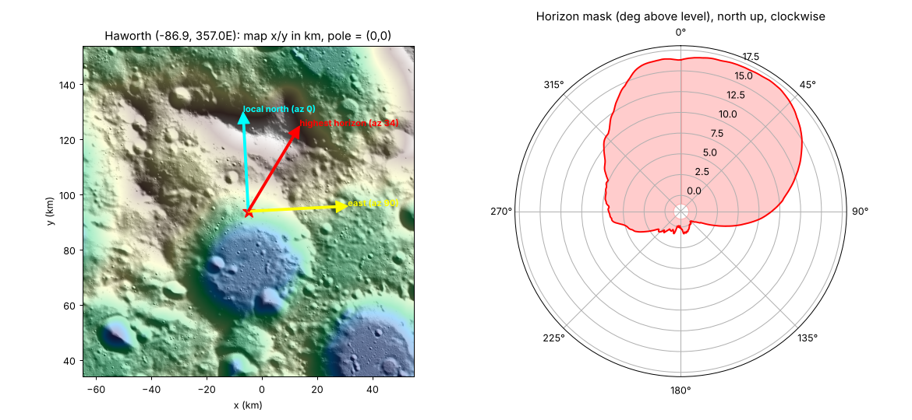

# Validating the horizon masks

The most likely bug in this project is a compass direction that is rotated or
mirrored (the README warns about the polar-stereographic rotation sign). We
checked it four ways. Status as of Sat 11:30 ET.

## 1. Fake Moon with known mountains: passed

`python terrain/tests/test_synthetic.py` builds a flat fake Moon in the same
projection, puts one 3 km Gaussian mountain at a known spot, and checks the
mask. Six sites at very different longitudes (0°, 90°, 180°, 222.7°, 270°, 355°)
all peak at the right azimuth to within 1°, with the expected angle to within
0.03°. Four "hand" cases place the mountain using plain lat/lon intuition: further
from the pole is north (az 0), closer to the pole is south (180), larger east
longitude is east (about 105 at 88°S, bent toward the pole by the shortest path),
smaller is west (about 255). All pass. A perfectly flat Moon seen from a 10 m mast
gives −0.19° in every direction, which is the curvature dip we expect.

## 2. Two independent methods agree on the real map: passed

`python terrain/tests/test_crosscheck.py` recomputes every site's mask a second
way, by hand in map x/y: at longitude λ, local north is (sin λ, cos λ) and local
east is (cos λ, −sin λ) on the map. This uses the README's flat formula and no
`pyproj.Geod`. Results on the real 80 m DEM:

| Site (placeholder coords) | median difference | correlation | mirrored (wrong sign) correlation |
| --- | --- | --- | --- |
| shackleton_ridge | 0.001° | 1.000 | 0.480 |
| haworth | 0.002° | 1.000 | 0.872 |
| malapert | 0.004° | 1.000 | −0.062 |
| mons_mouton_plateau | 0.008° | 1.000 | 0.391 |
| mons_mouton | 0.006° | 1.000 | −0.869 |
| nobile_rim_1 | 0.018° | 1.000 | −0.085 |
| nobile_rim_2 | 0.010° | 1.000 | 0.611 |
| de_gerlache_rim_2 | 0.003° | 1.000 | −0.810 |
| cabeus_b_peak | 0.039° | 1.000 | −0.255 |
| slater_plain | 0.003° | 1.000 | 0.886 |

The mirrored version disagrees badly, so the test can tell right from wrong.
This hand rotation is the same as the README code starter's, so that starter's
sign was right.

## 3. Pictures against the real terrain: looks right

`python terrain/plot_mask.py <site>` draws the shaded terrain map next to the
mask, with arrows for local north, east, and the highest horizon.

**Haworth** (placeholder point on the north inner rim of Haworth crater):
the mask is low (about 0°) looking south into the crater floor and high
(12–17°) looking north and north-east, where the map shows the high massif.
North points away from the pole, as it should.

**Shackleton connecting ridge** (placeholder point): Shackleton crater
(the round crater right of the site) and de Gerlache (upper left) are where the
map says they should be for their published centres. A high ridge site sees
past the flat horizon in most directions (mask −2.4° to +0.6°), which matches
why it is famous for long sunlight.

## 4. Still to do

- [ ] Quickmap screenshot: open https://quickmap.lroc.asu.edu at one site and
      confirm the crater or massif our mask points at (needs a human, 5 min).
- [ ] Once A's `/ephemeris` works: the connecting ridge should be sunlit most of
      the month, and Malapert should see Earth most of the time. If either comes
      out mostly dark, suspect the masks.
- [ ] Rerun with A's real coordinates. The placeholder points sometimes sit on
      a crater wall (e.g. nobile_rim_1 sees a 29° slope 400 m away), which is
      why exact coordinates matter so much at the pole.
