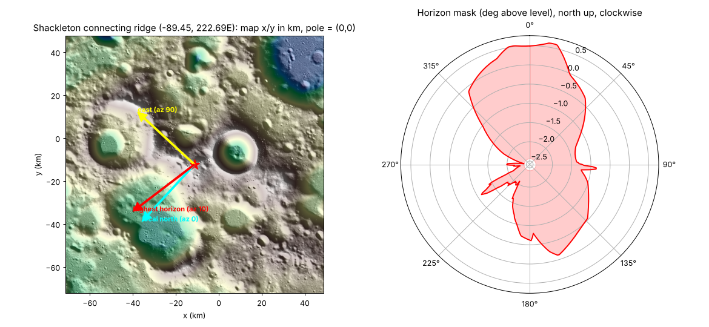
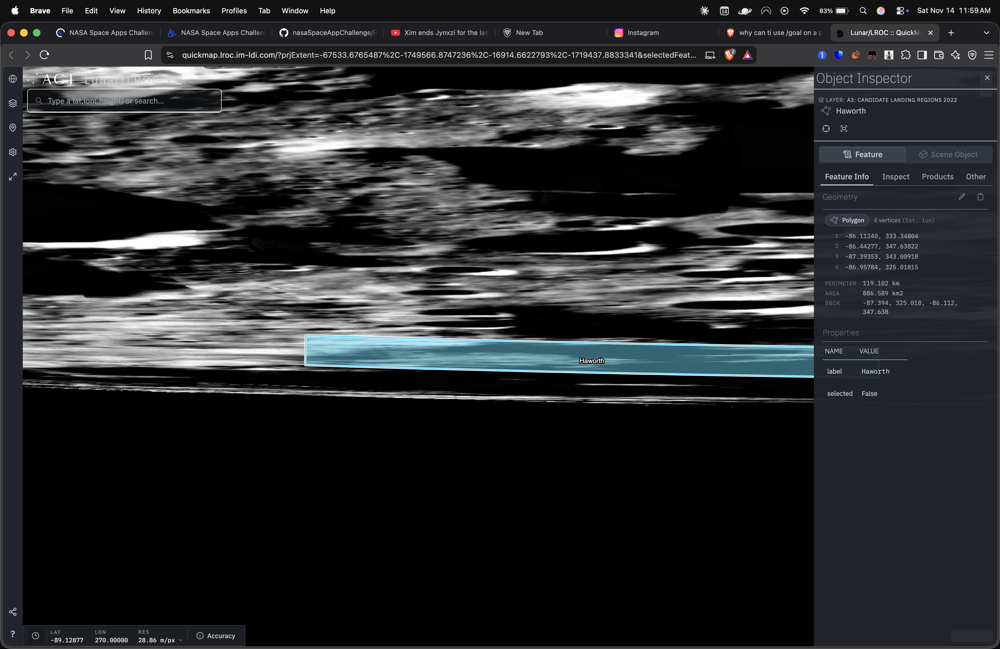
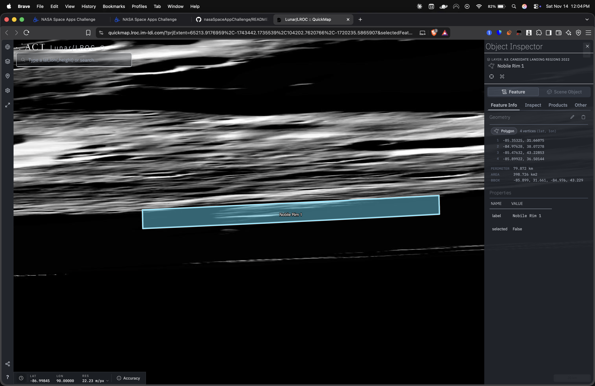

# Validating the horizon masks

The most likely bug in this project is a compass direction that is rotated or
mirrored (the README warns about the polar-stereographic rotation sign). We
checked it six ways. Status as of Sat 12:00 ET, using the site list on `main`.

## 1. Fake Moon with known mountains: passed

`python terrain/tests/test_synthetic.py` builds a flat fake Moon in the same
projection, puts one 3 km Gaussian mountain at a known spot, and checks the
mask. Six sites at very different longitudes (0°, 90°, 180°, 222.7°, 270°, 355°)
all peak at the right azimuth to within 1°, with the expected angle to within
0.03°. Four "hand" cases place the mountain using plain lat/lon intuition: further
from the pole is north (az 0), closer to the pole is south (180), larger east
longitude is east (about 105 at 88°S, bent toward the pole by the shortest path),
smaller is west (about 255). All pass. A perfectly flat Moon seen from a 10 m mast
gives −0.19° in every direction, which is the curvature dip we expect.

## 2. Two independent methods agree on the real map: passed

`python terrain/tests/test_crosscheck.py` recomputes every site's mask a second
way, by hand in map x/y: at longitude λ, local north is (sin λ, cos λ) and local
east is (cos λ, −sin λ) on the map. This uses the README's flat formula and no
`pyproj.Geod`. Results on the real 80 m DEM:

| Site (A's coords, PR #6) | median difference | correlation | mirrored (wrong sign) correlation |
| --- | --- | --- | --- |
| peak_near_cabeus_b | 0.003° | 1.000 | 0.902 |
| haworth | 0.004° | 1.000 | 0.546 |
| malapert_massif | 0.009° | 1.000 | −0.901 |
| mons_mouton_plateau | 0.008° | 1.000 | −0.647 |
| mons_mouton | 0.005° | 1.000 | 0.053 |
| nobile_rim_1 | 0.009° | 1.000 | −0.913 |
| nobile_rim_2 | 0.003° | 1.000 | −0.119 |
| de_gerlache_rim_2 | 0.004° | 1.000 | −0.772 |
| slater_plain | 0.001° | 1.000 | −0.120 |
| shackleton_connecting_ridge | 0.001° | 1.000 | 0.480 |

The mirrored version disagrees badly, so the test can tell right from wrong.
This hand rotation is the same as the README code starter's, so that starter's
sign was right.

## 3. Pictures against the real terrain: looks right

`python terrain/plot_mask.py <site>` draws the shaded terrain map next to the
mask, with arrows for local north, east, and the highest horizon.

**Haworth** (−87.45, 355.0): this point is the middle of Haworth crater's floor
(ground −3.3 km). The mask is high in every direction (3.4–10.3°), highest toward
the crater wall in the north-west, exactly the "bowl" the map shows. Important for
the app: the Sun at the pole never climbs above about 1.5°, so this point is
permanently dark. The NASA *region* is named after Haworth, but a landing point
should sit on the rim or plateau beside it, not on the crater floor.


**Shackleton connecting ridge** (−89.45, 222.69): Shackleton crater
(the round crater right of the site) and de Gerlache (upper left) are where the
map says they should be for their published centres. A high ridge site sees
past the flat horizon in most directions (mask −2.4° to +0.6°), which matches
why it is famous for long sunlight.



## 4. Sun and Earth with the real ephemeris: mostly as expected

`python terrain/sun_earth_check.py` uses A's cached JPL Horizons positions
(17 Nov 2026 to 14 Jan 2027, hourly) and counts the hours each body is above a
flat horizon, above the terrain mask, and above the 10 m mast mask:

```text
site                         sun flat  terrain    10m | earth flat  terrain    10m | sun max el
peak_near_cabeus_b              57.5%    52.7%  60.6% |      59.4%    74.0%  83.6% | 7.94
haworth                         71.1%    60.4%  61.4% |      57.6%    47.2%  47.2% | 3.51
malapert_massif                 58.7%    26.0%  35.0% |      68.7%    42.9%  57.4% | 5.52
mons_mouton_plateau             58.1%    61.6%  70.7% |      68.7%    52.5%  57.7% | 5.84
mons_mouton                     57.2%    51.8%  56.1% |      69.8%    92.7%  93.2% | 6.30
nobile_rim_1                    58.1%    73.9%  88.8% |      66.5%    25.8%  39.1% | 5.92
nobile_rim_2                    56.0%    36.2%  38.1% |      63.5%    21.7%  23.3% | 7.35
de_gerlache_rim_2               92.3%    99.7%  99.9% |      50.8%    43.9%  56.2% | 2.77
slater_plain                    63.2%    55.1%  57.6% |      36.8%    36.1%  38.0% | 4.43
shackleton_connecting_ridge    100.0%   100.0% 100.0% |      45.7%    48.6%  53.9% | 2.00
```

What matches published results:

- **Shackleton connecting ridge** is sunlit 100% of these hours, flat or terrain.
  It is famous as one of the best-lit spots at the pole, and this period is the
  pole's "summer". Its mask is below 0° in almost every direction (it sits high).
- **Terrain sunlight is lower than flat** at most sites, as it should be. Where it
  is higher (nobile_rim_1, mons_mouton_plateau, de_gerlache_rim_2) the site sits
  on a high point whose horizon dips below 0° toward the Sun.
- **The big negative masks A asked about are real geometry.** nobile_rim_1
  (ground 5,846 m) has its lowest horizon, −5.9°, at az 107. Along that ray the
  ground falls 4 km in the first 10 km (up to 22° below level) into a basin about
  3.5 km below the site, and even the far side 74–150 km away stays 6–7° below
  level once curvature is counted. mons_mouton_plateau (4,293 m) is the same
  story at az 205: −14° within 5 km, −4.4° at 100–150 km. The Sun 0–3° below the
  flat horizon toward the pole really does clear that terrain. One caveat: a
  5.8 km summit is the Mons Mouton massif's height, not Nobile's rim, so the
  nobile_rim_1 point may have drifted onto the massif (worth a Quickmap look).
- **Earth gains at high points** (mons_mouton 70% → 93%, peak_near_cabeus_b
  59% → 74%): the mask is 2–4° below 0° toward Earth (A checked this too).

What looked wrong, and why:

- **Malapert Massif** came out at only 26% Sun and 43% Earth with terrain,
  though it is known for good Sun and Earth visibility. The point (−86.0, 2.9) sits
  in a small crater about 300 m across and 30 m deep on the summit plateau (visible
  in the raw 80 m heights), so nearby rims at 160–240 m block 1–8° all round.
  The mask is right for that exact point. Moving 1.6 km to the plateau at
  **−86.0187, 2.2013** gives 100% Sun and 50% Earth over the same hours. Suggested
  to A in `suggested_points.md`.

## 5. Quickmap: site points against the official region outlines

Quickmap's "Candidate landing regions" layer gives each region's outline.
Lucas checked Haworth (screenshot below, vertices saved in `regions.json`).
Finding: our Haworth point had drifted ~60 km outside the region when we moved
it off the crater floor onto the nearest open rim. `best_in_region.py` now picks
the best point *inside* an outline; for Haworth that is −86.9737, 335.6129
(mean horizon about 0°). A moved Haworth there (#17) and the mask was rebuilt (#18).



**Nobile Rim 1:** our point (−85.6169, 37.9129) is **inside** the official
outline (also in `regions.json`). Searching the whole region finds nothing
clearly better: the best points have the same mean horizon (about −0.5°), so
the point stays. Its 5.8 km ground height is simply how high this rim is.



**Malapert:** Quickmap's nomenclature entry is Malapert *crater* (centre
−85.0, 11.4, 72 km wide, spanning −85.99 to −83.97 lat). Our point
(−86.0187, 2.2013) is just south of the crater's edge, on the massif that forms
its southern rim, which is where the "Malapert Massif" region is. The candidate
region outline itself was not checked.

## 6. Still to do

- [x] Quickmap: Haworth region outline checked (section 5).
- [x] Nobile Rim 1 inside its outline; Malapert on the massif south of the crater.
- [ ] Outlines not checked: Malapert Massif region, Nobile Rim 2, Mons Mouton,
      Mons Mouton Plateau, de Gerlache Rim 2, Slater Plain, Peak near Cabeus B.
- [x] Sun/Earth check with A's cache (section 4). Ridge 100% sunlit; Malapert
      low only because of its exact point (fix suggested to A).
- [x] Rerun with A's coordinates (PR #6). Several points still sit on steep
      slopes or in craters, and the mask there is dominated by ground within 1 km:
      haworth (crater floor, permanently dark), mons_mouton_plateau (23° at 200 m),
      nobile_rim_1 (26° at 1 km), de_gerlache_rim_2 (24° at 200 m). A moved all
      four to the suggested points (#9) and the masks were rebuilt (#12).
